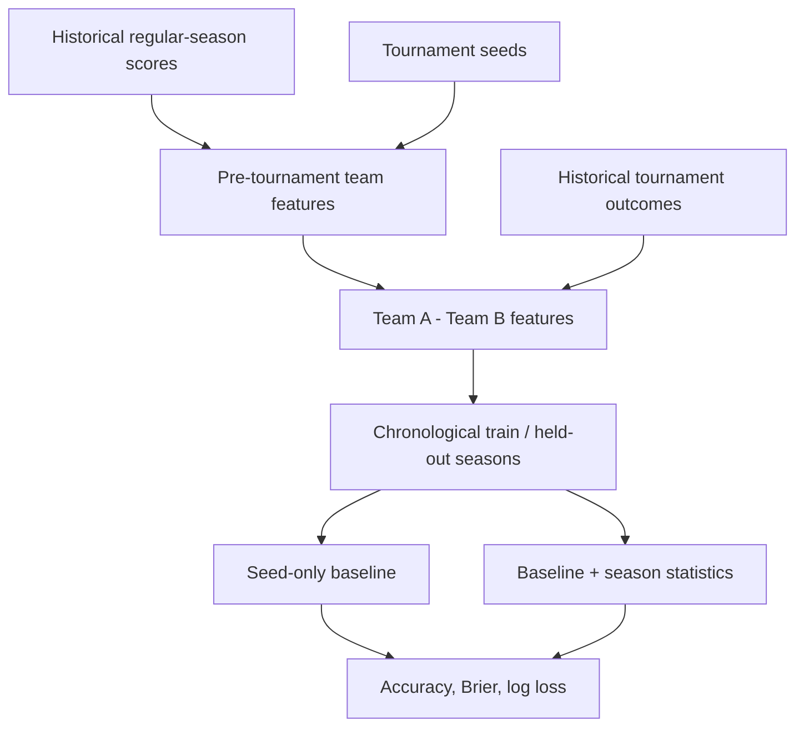

# March Madness Model Lab

An independent, reproducible exploration of predicting NCAA tournament matchups with pre-game information. This project evolves an earlier exploratory notebook into a transparent modeling pipeline.

**Question:** Can historical regular-season performance and tournament seeds produce calibrated win probabilities that outperform a simple seed-based baseline on *unseen seasons*?

## Principles

- Predict a binary game outcome, not the winning team's seed.
- Calculate team features using information available before the tournament.
- Hold out entire seasons during evaluation to simulate real forecasts.
- Report accuracy **and** probability quality (log loss and Brier score), against a seed baseline.
- Keep data downloads, personal paths, notebook outputs, and credentials out of version control.

## What is implemented

- Deterministic team aggregation from regular-season games, including win rate,
  points scored, points allowed, and point differential.
- Matchup feature differences with a real binary winning-team target, independent
  of the teams' order in the input.
- Chronological backtesting: for test year `Y`, train on years strictly earlier
  than `Y`. Pre-tournament statistics from year `Y` are allowed.
- Two comparable, regularized logistic regressions: seed-only and seed plus
  regular-season data.
- Accuracy, Brier score, and log loss by held-out season; equal-season summary.
- An executable command-line workflow, continuous-integration configuration,
  and six dependency-free unit tests (using the standard-library test runner).

**Honest status:** The six synthetic-fixture tests pass. No numerical
performance claim is made yet: the complete historical CSVs are not bundled
and the real-data backtest has not been executed in this repository.

## Reproduce the analysis

1. Download the data from the [Kaggle March Machine Learning Mania 2026
   competition](https://www.kaggle.com/competitions/march-machine-learning-mania-2026/data).
   Use Kaggle's website or authenticated CLI. Keep personal Kaggle credentials
   outside this repository.
2. Place these three men's CSVs in a local `data/` folder:
   - `MRegularSeasonCompactResults.csv`
   - `MNCAATourneyCompactResults.csv`
   - `MNCAATourneySeeds.csv`
3. From the repository root, run:

```bash
python -m pip install -e .
python -m unittest discover -s tests -v
python -m madness_lab.cli --data-dir data --last-n-seasons 5 --output artifacts/backtest.json
```

The CLI prints a summary table and optionally writes a per-season JSON report.
Run the [walkthrough notebook](notebooks/01_rebuild.ipynb) after installation
to inspect the underlying features and results. Neither private credentials
nor copyrighted third-party data are tracked in Git.

## Architecture



The prediction label comes from tournament results; it is never included among
the model's feature columns. See [research notes](RESEARCH_NOTES.md) for a candid
review of how the original experiment was redesigned.

## Next experiments

1. Run the complete historical backtest and publish held-out-year metrics.
2. Add probability calibration plots and sensitivity tests.
3. Test opponent-adjusted ratings against the seed-only baseline.
4. Score arbitrary future matchups from a frozen pre-tournament snapshot, then
   add a simple bracket explorer.

## Provenance

The research question originated in a graduate course exploration using
[Nishaan Amin's March Madness dataset](https://www.kaggle.com/datasets/nishaanamin/march-madness-data).
The earlier notebook's joins and modeling were not fit for prospective
prediction. This independent rebuild makes the task reproducible and documents
the shortcomings transparently. All work here uses public data only.
