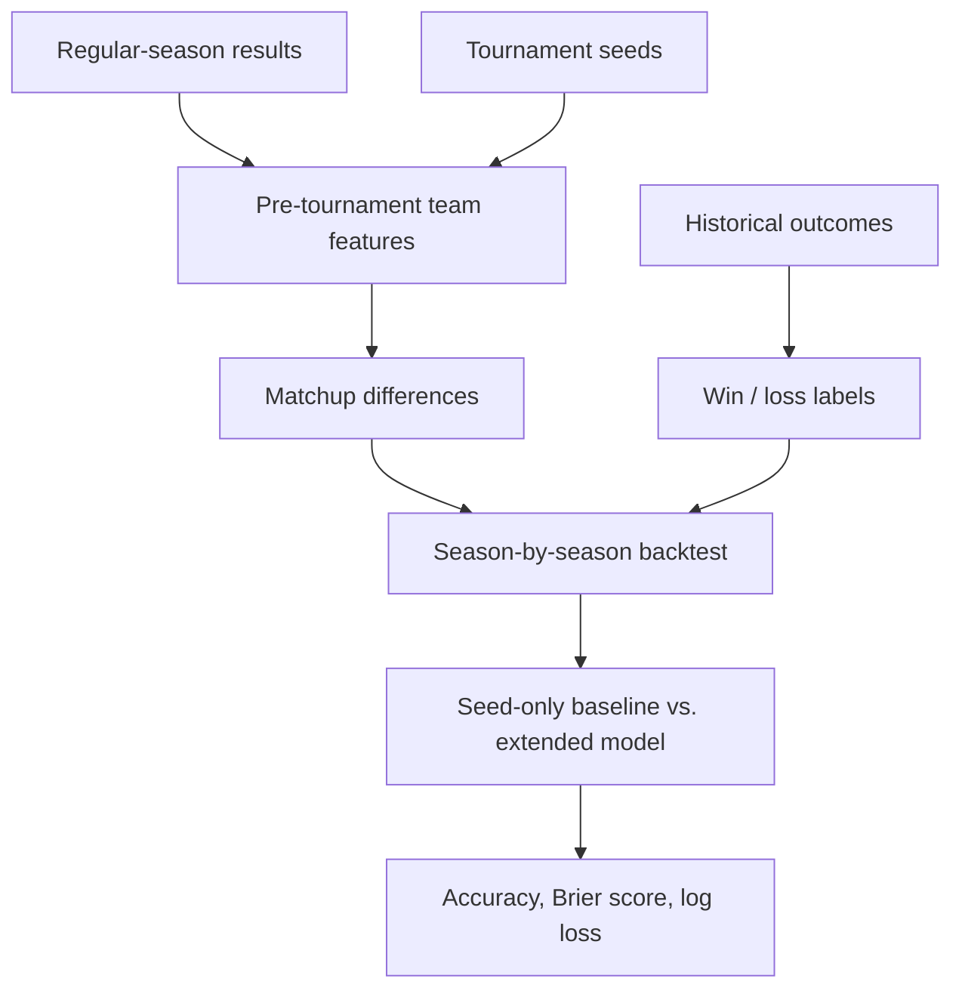

# March Madness Model Lab

**Can regular-season performance improve NCAA tournament predictions beyond what seeding already tells us?**

A reproducible Python modeling lab comparing a seed-only baseline with a matchup model incorporating pre-tournament team statistics. The focus is on a credible evaluation process—not an impressive-looking prediction without a defensible backtest.

**Project type:** Independent model engineering | **Stack:** Python, data pipelines, logistic regression, GitHub Actions

## The problem

Tournament seeds are a powerful shorthand for team strength. The practical modeling question is whether historical regular-season performance adds meaningful information when the model is evaluated on **entire seasons it has never seen**.

## What is implemented

- Converts regular-season game results into season-level team features: win rate, scoring, points allowed, and point differential.
- Builds ordered tournament matchups with an actual **win/loss** prediction target.
- Trains only on seasons earlier than each held-out test season.
- Compares seed-only and seed-plus-statistics regularized logistic regression models.
- Evaluates accuracy **and probability quality** through Brier score and log loss.
- Includes a CLI, research walkthrough, GitHub Actions, and six passing synthetic-fixture unit tests.

## Model workflow



## Results and evidence

**Current status:** The pipeline and six synthetic tests are implemented. **Real historical backtest results have not been executed or published here**, so there is no defensible claim that the extended model outperforms seeding.

This distinction matters: a passing unit test proves selected code behavior, not forecasting skill.

## Run it yourself

Use the [Kaggle March Machine Learning Mania 2026 data](https://www.kaggle.com/competitions/march-machine-learning-mania-2026/data) and place `MRegularSeasonCompactResults.csv`, `MNCAATourneyCompactResults.csv`, and `MNCAATourneySeeds.csv` in a local `data/` directory.

```bash
python -m pip install -e .
python -m unittest discover -s tests -v
python -m madness_lab.cli --data-dir data --last-n-seasons 5 --output artifacts/backtest.json
```

See the [walkthrough notebook](notebooks/01_rebuild.ipynb) and [research notes](RESEARCH_NOTES.md) for the implementation and methodological decisions. Historical competition data and credentials are not committed.

## Engineering decisions

**Prevent leakage:** The label is never used as a feature; model training uses only earlier seasons. The held-out year's regular-season statistics are legitimate because they exist before tournament play.

**Benchmark honestly:** A complex model is worthwhile only if it improves on a simple, relevant baseline. Probability metrics assess confidence, not merely winner picks.

**Make experiments repeatable:** A command-line runner, stable transformations, tests, and per-season reporting reduce reliance on ad hoc notebook execution.

## Next milestones

Run the historical backtest and publish actual performance; evaluate calibration and opponent-adjusted ratings; then explore a matchup and bracket interface driven by frozen pre-tournament snapshots.

The idea began as an earlier graduate exploration. This independently rebuilt implementation corrects the original target/validation approach and intentionally documents unresolved questions.
